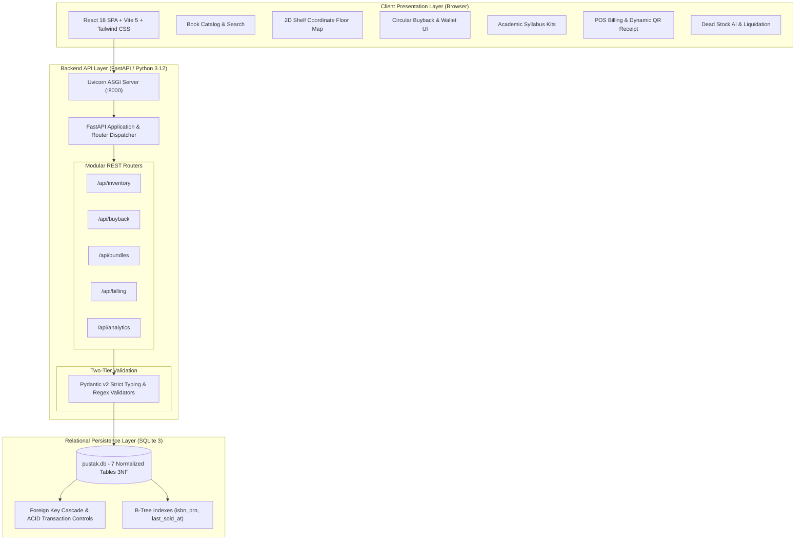
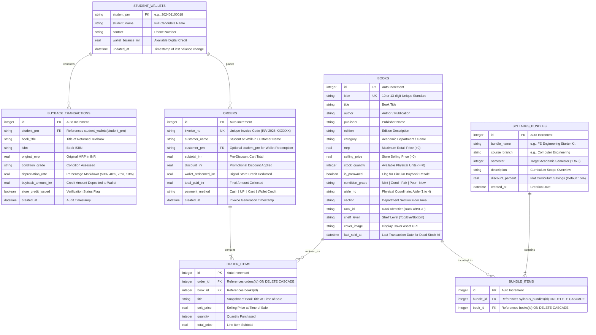

# 🗄️ Pustak Database Architecture & System Design Specification

**Candidate:** Nikita Sharad Pawar | **PRN:** `202401100018` | **Roll:** `A19`  
**System:** Pustak — Smart Academic Bookstore & Circular Textbook Buyback Platform  
**Database Engine:** SQLite 3 (ACID Relational, Foreign Keys Enforced, B-Tree Indexed)

---

## 1. High-Level System Architecture

---

## 2. Entity-Relationship (ER) Diagram (3NF Normalized)

---

## 3. Database Integrity & Indexing Strategy

To guarantee rapid queries and zero performance bottlenecks during checkout or catalog searches, SQLite B-Tree indexes are explicitly created:

1. **`idx_books_isbn` ON `books(isbn)`**: Enables O(1) instantaneous ISBN lookup during book registration, inventory lookup, and POS barcode scanning.
2. **`idx_books_category` ON `books(category)`**: Accelerates catalog filtering by engineering department (Computer Science, Mechanical, Mathematics).
3. **`idx_books_last_sold` ON `books(last_sold_at)`**: Powers the Dead Stock AI engine by quickly calculating dormant stock without full table scans.
4. **`idx_wallets_prn` ON `student_wallets(student_prn)`**: Instantaneous balance verification and atomic credit updates during circular buyback and POS checkout.
5. **Foreign Key Enforcement**: Initialized with `PRAGMA foreign_keys = ON;` in every database connection to prevent orphan child records when books or orders are modified.
